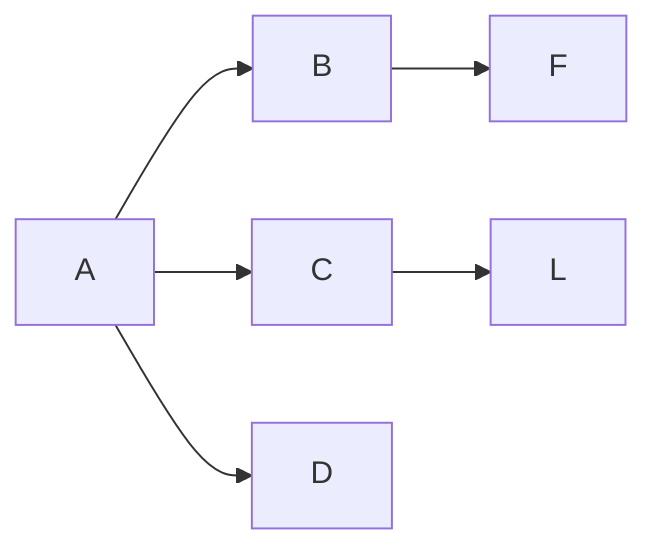
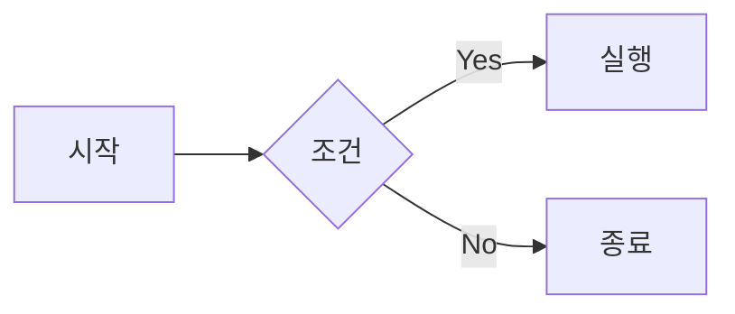

# Markdown(마크다운) 정리

> 마크다운은 간단한 기호와 문법을 사용하여 문서의 구조와 서식을 지정하는 경량 마크업 언어이다.

## 1. 줄바꿈과 문단 구분

마크다운은 일반적인 엔터 한 번으로 줄바꿈이 적용되지 않을 수 있다.

| 입력 방식 | 기능 |
|---|---|
| 엔터 1번 | 일반적으로 줄바꿈 미적용 |
| 엔터 2번 | 문단 구분 |
| 문장 끝 공백 2개 + 엔터 | 같은 문단 내 줄바꿈 |
| `<br>` | 강제 줄바꿈 |

**예시**

```markdown
첫 번째 문장

두 번째 문장
```

```markdown
첫 번째 문장  
두 번째 문장
```

---

## 2. 제목(Heading)

`#`의 개수에 따라 제목의 크기와 단계가 달라진다.

| 문법 | 제목 단계 |
|---|---|
| `# 제목` | 제목 1 |
| `## 제목` | 제목 2 |
| `### 제목` | 제목 3 |
| `#### 제목` | 제목 4 |
| `##### 제목` | 제목 5 |
| `###### 제목` | 제목 6 |

**주의사항**
- `#` 뒤에는 공백을 넣어야 한다.
- 일반적으로 제목 1~3을 많이 사용한다.
- 제목은 최대 6단계까지 지원한다.
- `#######`은 제목 문법으로 인식되지 않는다.
- 옵시디언 등에서는 `#태그` 형태로 태그 기능도 사용한다.

---

## 3. 구분선(Horizontal Rule)

문서의 내용을 구분하거나 맥락을 끊을 때 사용한다.

```markdown
---
___
***
```

세 가지 모두 일반적으로 구분선으로 사용된다.

---

## 4. 리스트(List)

### 4-1. 순서 없는 리스트(Unordered List)

`-`, `*`, `+` 기호를 사용한다.

```markdown
- 좋아하는 것
  - 수박
  - 캔디
  - Neon

* 사과
* 바나나

+ 딸기
+ 포도
```

**주의사항**
- 기호 뒤에는 공백을 넣는다.
- 하위 항목은 들여쓰기를 사용한다.

### 4-2. 순서 있는 리스트(Ordered List)

숫자와 마침표를 사용한다.

```markdown
1. 리센느 - with
2. 리센느 - 백화요란
3. A20 Lite - Neon
4. A20 Soul - ????
5. A20 May - ?????
```

**특징**

```markdown
1. 첫 번째
1. 두 번째
1. 세 번째
```

일부 마크다운 렌더러에서는 자동으로 1, 2, 3 순서로 표시한다.

### 4-3. 체크리스트(Check List)

```markdown
- [ ] 해야 할 일
- [x] 완료한 일
- [ ] 진행 중인 일
```

GitHub README, Issue 등에서 활용한다.

---

## 5. 글자 꾸미기(Emphasis)

| 문법 | 기능 | 예시 |
|---|---|---|
| `*내용*` | 기울임 | *내용* |
| `_내용_` | 기울임 | _내용_ |
| `**내용**` | 굵게 | **내용** |
| `__내용__` | 굵게 | __내용__ |
| `~~내용~~` | 취소선 | ~~내용~~ |
| `` `내용` `` | 인라인 코드 | `내용` |

### 중첩 사용

```markdown
***굵게 + 기울임***

**_굵게 + 기울임_**
```

### 형광펜 효과(HTML)

```html
<mark>형광펜 효과</mark>
```

※ HTML 태그는 사용하는 마크다운 환경에 따라 지원 여부가 다를 수 있다.

---

## 6. 코드(Code)

### 6-1. 인라인 코드(Inline Code)

백틱(`) 하나로 감싼다.

```markdown
`print("Hello World")`
```

문장 안에서 명령어나 코드를 강조할 때 사용한다.

### 6-2. 코드 블록(Code Block)

백틱 3개로 감싼다.

````markdown
```
코드 내용
12345678
```
````

### 6-3. 프로그래밍 언어 지정

백틱 3개 뒤에 언어 이름을 입력하면 문법 강조(Syntax Highlighting)가 적용된다.

````markdown
```python
print("Hello World")
```
````

**자주 사용하는 언어**

- `python`
- `javascript`
- `sql`
- `html`
- `css`
- `mermaid`

---

## 7. 다이어그램(Mermaid)

Mermaid는 텍스트로 순서도와 다이어그램을 작성하는 도구이다.

### 기본 문법

````markdown

````

### 방향 지정

| 문법 | 의미 |
|---|---|
| `LR` | Left to Right (왼쪽 → 오른쪽) |
| `RL` | Right to Left (오른쪽 → 왼쪽) |
| `TB` | Top to Bottom (위쪽 → 아래쪽) |
| `BT` | Bottom to Top (아래쪽 → 위쪽) |

### 순서도 예시

````markdown

````

---

## 8. 인용문(Blockquote)

`>` 기호를 사용한다.

```markdown
> 여러분들 스트레칭 하세요
> - 지나가던 프로그래밍 아저씨
```

### 중첩 인용문

```markdown
> 1단계 인용
>> 2단계 인용
>>> 3단계 인용
```

인용문 안에 또 다른 인용문을 작성할 수 있다.

---

## 9. 링크(Link)와 이미지(Image)

### 9-1. 링크 연결

```markdown
[네이버 바로가기](https://naver.com)
```

- `[ ]` : 화면에 표시할 텍스트
- `( )` : 연결할 URL

### 9-2. 인라인 코드로 표시

```markdown
`[네이버](https://naver.com)`
```

링크가 실행되지 않고 코드 형태로 표시된다.

### 9-3. 이미지 삽입

```markdown

```

- `!` : 이미지 삽입 표시
- `[ ]` : 이미지 대체 텍스트(Alt Text)
- `( )` : 이미지 URL

### 9-4. 이미지에 링크 연결하기

```markdown
[](접속URL)
```

이미지를 클릭하면 지정한 웹사이트로 이동한다.

---

## 10. HTML 태그 활용

마크다운에서 지원하지 않는 일부 기능은 HTML 태그로 구현할 수 있다.

### 가운데 정렬

```html
<center>가운데 정렬</center>
```

### 강제 줄바꿈

```html
<br>
```

### 형광펜 효과

```html
<mark>강조할 내용</mark>
```

※ GitHub에서는 일부 HTML 태그와 속성이 제한될 수 있다.

---

## 11. 표(Table)

파이프(`|`) 기호를 사용하여 표를 작성한다.

### 11-1. 기본 표

```markdown
| 제목1 | 제목2 | 제목3 |
|---|---|---|
| 내용1 | 내용2 | 내용3 |
| 내용4 | 내용5 | 내용6 |
```

### 11-2. 표 정렬

| 문법 | 정렬 방식 |
|---|---|
| `:---` | 왼쪽 정렬 |
| `---:` | 오른쪽 정렬 |
| `:---:` | 가운데 정렬 |

**예시**

```markdown
| 왼쪽 | 가운데 | 오른쪽 |
|:---|:---:|---:|
| 내용1 | 내용2 | 내용3 |
```

**기억할 것**
- `:`이 앞에 있으면 왼쪽 정렬
- `:`이 뒤에 있으면 오른쪽 정렬
- 양쪽에 있으면 가운데 정렬
- 헤더와 구분선이 필요하다.

---

## 12. 주석(Comment)

HTML 주석 문법을 사용한다.

```html
<!-- 이 부분은 주석입니다. -->
```

- 문서 화면에 표시되지 않는다.
- 코드나 문서에 작성자만 확인할 메모를 남길 때 사용한다.
- `Ctrl + /`는 편집기별 주석 단축키로 제공될 수 있다.

---

# 13. 핵심 문법 요약

| 기능 | 문법 |
|---|---|
| 제목 | `# 제목` |
| 구분선 | `---` |
| 순서 없는 리스트 | `- 내용` |
| 순서 있는 리스트 | `1. 내용` |
| 체크박스 | `- [ ] 내용` |
| 기울임 | `*내용*` |
| 굵게 | `**내용**` |
| 취소선 | `~~내용~~` |
| 인라인 코드 | `` `코드` `` |
| 코드 블록 | 백틱 3개 |
| 인용문 | `> 내용` |
| 링크 | `[텍스트](URL)` |
| 이미지 | `` |
| 표 | `\|` |
| 가운데 정렬 | `<center>` |
| 강제 줄바꿈 | `<br>` |
| 형광펜 | `<mark>` |
| 주석 | `<!-- 내용 -->` |

---

# 14. 실습 체크리스트

- [ ] 제목 1~6단계 작성하기
- [ ] 구분선 3가지 작성하기
- [ ] 순서 없는 리스트 작성하기
- [ ] 순서 있는 리스트 작성하기
- [ ] 체크박스 작성하기
- [ ] 굵게, 기울임, 취소선 적용하기
- [ ] 인라인 코드 작성하기
- [ ] 코드 블록과 Python 코드 작성하기
- [ ] Mermaid 순서도 작성하기
- [ ] 인용문 작성하기
- [ ] 외부 링크 연결하기
- [ ] 이미지 삽입하기
- [ ] 이미지에 링크 연결하기
- [ ] 표 작성 및 정렬하기
- [ ] HTML 주석 작성하기

---

**학습 목표:** 마크다운 문법을 활용하여 GitHub README.md 파일을 직접 작성하고 꾸밀 수 있다.
