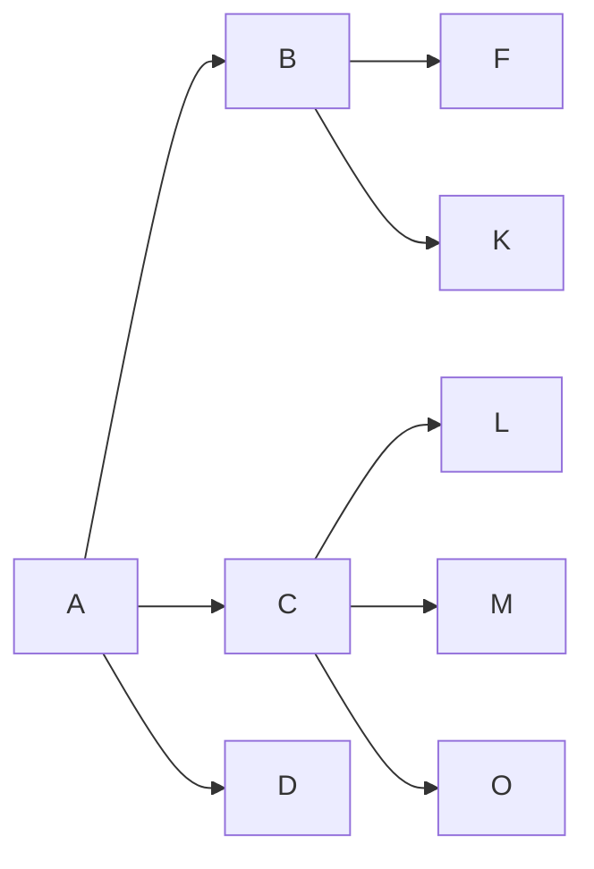

.md - 마크다운
마크다운은 엔터를 줄바꿈으로 인정하지 X

엔터가 두 번 되어야 다른 문단으로 인식

공백두번(..)
같은 문단 내 줄바꿈으로 인식

문단 줄바꿈  
문단 내 줄바꿈<br>줄바꿈

# 제목1
#바로붙으면.태그처럼 인식함 # 다음에 숫자를 붙여서 이슈 호출이나 연관 기능
옵시디언, 메모 앱들은 # 다음으로 태그를 씀
(노션, 슬랙, 디스코드들... #??? <<이유 : 빈자리여서>>)
## 제목 2
이쁘지 않아서 2번까지 많이씀
### 제목 3
일반적으로 3번까지 쓰지만 (글로벌 표준)
###### 제목6 까지 있음
####### 안먹음  
(일반적으로 #, ##은 구분선을 사용해서 제목과 부제목을 의미함)  
--- ___ +++ === 보통은 --- {구분선} -> 맥락을 끊어준다


순서 없는 리스트
- 순서가 없음
- 내가 좋아하는 건
    - 수박
    - 캔디
    - neon  
    -- tap등을 사용한 들여쓰기
* 별표도 된다(문법적 특징때문에 꼭 띄어쓰기 해야함)
+ 플러스도 됩니다

순서 있는 리스트 (충격적이다)

1. 리센느 - with
2. 리센느 - 백화요란
4. A20 Lite - Neon
3. A20 Soul - ????
0. A20 May - ?????
11. 
1.
1.
1.
1.
1.
1.
---
1.
1.
1.
#
1.
1.
<!-- ctrl + / = 주석 (마크업 랭귀지 주석) -->
- [ ] 체크박스? - github issue, readme 해석시 특수문법
~~되기도하고~~ 취소문법 ~~   
==ㄹㄹㄹ== 안됨

# 꾸미기 문법
*기울이기* _기울이기_ *_ 됨  
+기울이기+ 안됨  
**진하게** __진하게__
***기울진*** ___기울진___ 
* 내가 원한 건 말머리표인데
*붙여가지고 안뜨거나
*앞뒤로붙여서기울거나*  
~~취소선~~   <mark>형광펜태그</mark>  
'~~취소선~~'  
' ' - 인라인 코드
``` ```
코드박스
12345678
```python
print("Hello World")
```



>인용
> > 인용 안에 인용
> > > 인용 안에 인용 안에 인용

> 여러분들 스트레칭 하세요
> \- 지나가던 프로그래밍 아저씨